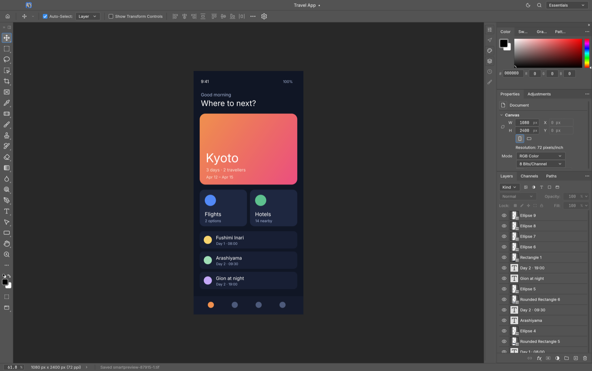
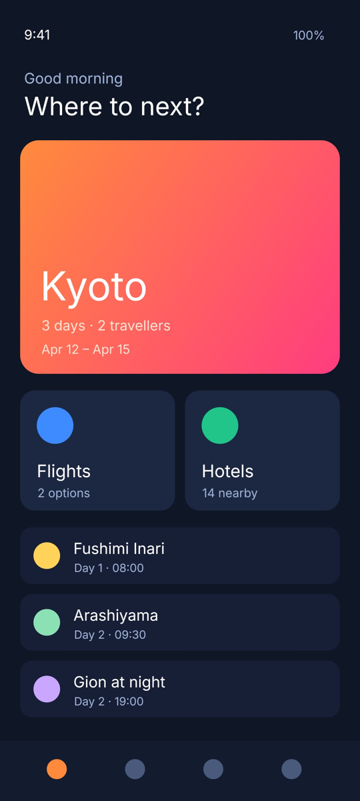
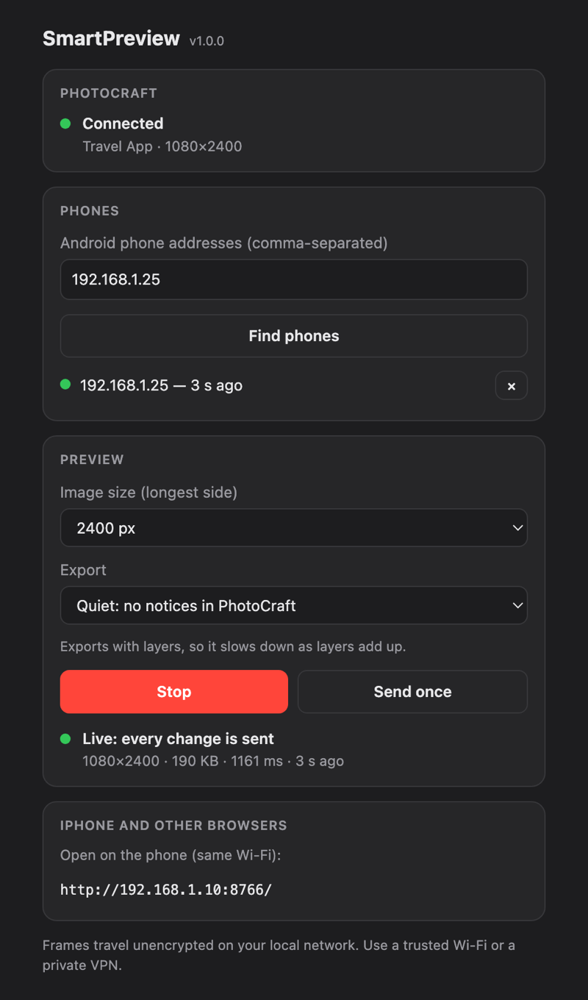
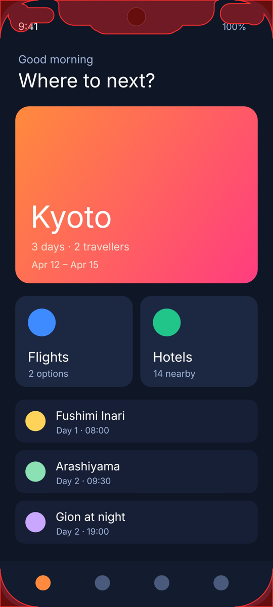
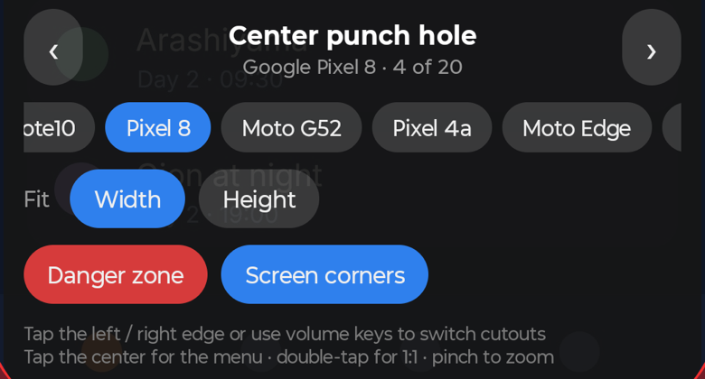

# SmartPreview — PhotoCraft canvas live on your phone

[Русский](README.ru.md)

See the PhotoCraft document you are editing on a real phone, live. Every edit, undo and
document switch sends a picture of the document (not a screenshot of the window) to the
**SmartPreview** Android app or to any phone browser. On the phone you can simulate other
phones' camera cutouts, rounded screen corners and the combined "danger zone".

<table>
  <tr>
    <td width="68%"></td>
    <td width="32%"></td>
  </tr>
  <tr>
    <td align="center">Edit in PhotoCraft…</td>
    <td align="center">…see it on the phone</td>
  </tr>
</table>

## What is in the repository

| Path | What it is |
| --- | --- |
| `connector/` | The PhotoCraft connector (Python 3, standard library only) and its control panel |
| `android/` | The SmartPreview Android app: full-screen viewer, zoom, simulated cutouts |
| `connector/viewer.html` | The phone-browser viewer, for iPhone and anything else |
| `SmartPreview.command` / `SmartPreview.bat` | Double-click launchers for macOS / Windows |
| `tests/` | Connector checks: `python3 -m unittest discover -s tests` |

### Why a connector and not a PhotoCraft plug-in

PhotoCraft plug-ins are sandboxed WebAssembly filters with no network or file access, so a
plug-in cannot send anything to a phone. SmartPreview runs next to PhotoCraft instead and
uses PhotoCraft's built-in control server:

```text
PhotoCraft ──(127.0.0.1 control server, HMAC challenge auth)──► SmartPreview connector
                                                                  │  exports the active document when its revision changes
                                                                  ├──► Android app  (HTTP POST, port 8767)
                                                                  └──► phone browser (http://computer:8766/)
```

The control token never leaves your computer: the connector proves it knows the token with
an HMAC challenge, so a program squatting on the port learns nothing.

## Requirements

- **PhotoCraft** with the control server (tested with 0.23.1 on macOS).
- **Python 3.8+** on the computer. No packages are needed on macOS.
- **Android 7.0+** for the app, or any modern phone browser.
- The computer and the phone on the **same Wi-Fi** (or the same private VPN, such as Tailscale).

## Tutorial

### 1. Install the app on the phone

Install `SmartPreview.apk` (from the [Releases](../../releases) page, or build it, see below)
and open **SmartPreview**. Until the first picture arrives, the app shows the phone's
address, for example `192.168.1.25:8767`.

From a computer with `adb`:

```bash
adb install -r SmartPreview.apk
```

### 2. Start the connector

1. Save your work and **quit PhotoCraft**.
2. Double-click **`SmartPreview.command`** (macOS) or **`SmartPreview.bat`** (Windows), or run:

   ```bash
   python3 connector/smartpreview.py
   ```

The connector starts PhotoCraft with the control server switched on and opens the panel at
`http://localhost:8766/panel`. Keep its terminal window open while you work.

Why PhotoCraft has to be started by SmartPreview: when PhotoCraft is opened from the Dock,
only PhotoCraft knows the token of its control server. SmartPreview starts it like this:

```bash
open -a PhotoCraft --args --control 8975 --control-token-file "$HOME/Library/Application Support/SmartPreview/control.token" --automation-write-root "$HOME/Library/Application Support/SmartPreview/frames"
```

The write root is the only folder automation may write to in that session (frames pass
through it and are deleted right away); automation gets no read access at all.

If PhotoCraft is already open, the panel says **No access to PhotoCraft**. Save your work,
quit PhotoCraft and click **Open PhotoCraft** in the panel.

### 3. Connect the phone



In the panel:

1. Click **Find phones**. Every phone with SmartPreview open on the same network answers.
2. Click **Add** next to your phone, or type its address into **Android phone addresses**.
   Several phones are fine: separate them with commas.
3. Make sure **Live** is on (the red **Stop** button means it is running).

That's it: draw, move layers, undo. The phone follows.

**Send once** sends a single frame, also while live updates are stopped.
**Image size** limits the longest side of the frame (2400 px by default, so a 1080×2400
design arrives pixel for pixel).

The panel answers only on this computer. Settings are saved between runs.

<br clear="right">

### 4. Check cutouts and the danger zone



Tap the centre of the phone screen to open the menu:

- **‹ ›** or the chips: pick one of 20 cutout profiles (punch holes, notches, Dynamic Island…).
  Tapping the left / right edge of the screen or pressing the volume keys does the same.
- **Width / Height**: fit the frame to the screen width or height.
- **Danger zone**: paints in red everything covered by the simulated cutouts and corners.
- **Screen corners**: rounded corners of the simulated phone.

Double-tap toggles fit ↔ 1:1 pixels; pinch to zoom, drag to pan. The zoom is kept while
frames of the same size arrive, so you can retouch a detail and watch it at 1:1.

Cutouts scale with the screen width and rotate with the device; `≈` marks approximate
shapes. They are a design aid, not device certification.

<br clear="right">

<p align="center"></p>

### 5. iPhone and other browsers

Open the address shown under **iPhone and other browsers** in the panel, for example
`http://192.168.1.10:8766/`, on the phone. The browser viewer has the same cutouts, danger
zone and gestures. In Safari, **Share → Add to Home Screen** gives a full-screen viewer.

## Export modes: quiet or fast

The PhotoCraft desktop app has no "render the composite" call, so each frame is an export
to the connector's folder. PhotoCraft shows every export warning as a notice card, and a
flat export of a layered document always warns ("N layer(s) flattened").

| Mode | How | Speed (measured) | Notices in PhotoCraft |
| --- | --- | --- | --- |
| **Quiet** (default) | layered TIFF → JPEG | 60–80 ms export with 3 layers; grows with layers (~0.6 s with 8, ~1–1.3 s end to end with 11 full-canvas fill layers) | none (a "Saved …" line in the status bar) |
| **Fast** | flat TIFF → JPEG | ~35 ms export, ~0.2 s end to end | a notice card for every frame of a layered document |

- PSD/PSB are never used: that export re-targets the document to the frame file, and
  ⌘S would save your work into the SmartPreview folder. TIFF leaves the document alone.
- PhotoCraft's UI does not stall while a frame is exported.
- On macOS the TIFF → JPEG conversion and scaling use the built-in `sips`. On Windows and
  Linux install Pillow (`pip install pillow`); without it frames are sent as PNG at the
  document size, and layered documents show a notice.

Switch the mode in the panel, or start with `--fast`.

## Connector options

```bash
python3 connector/smartpreview.py --help
```

| Option | Meaning |
| --- | --- |
| `--phones 192.168.1.25,192.168.1.26` | Phone addresses (default: the ones saved in the panel) |
| `--size 0\|1080\|1600\|2400\|4000` | Longest side in px; `0` = the document's own size |
| `--fast` | Fast export mode |
| `--discover` | List SmartPreview phones on the network and exit |
| `--once` | Send one frame and exit |
| `--no-launch` | Never start PhotoCraft |
| `--no-browser` | Do not open the panel |
| `--token-file`, `--control-port` | For a PhotoCraft you started with your own control flags |
| `--http-port` | Panel and browser viewer port (default 8766) |

Settings, the control token and temporary frames live in
`~/Library/Application Support/SmartPreview/` (Windows: `%APPDATA%\SmartPreview`,
Linux: `~/.local/share/smartpreview`), never in the repository.

## Troubleshooting

- **Find phones finds nothing**: keep SmartPreview open and the screen on, check that both
  devices are on the same network (guest Wi-Fi often isolates devices) and allow Python
  through the computer's firewall. Typing the address shown on the phone always works.
- **No access to PhotoCraft**: PhotoCraft was opened without SmartPreview; quit it and use
  **Open PhotoCraft** in the panel.
- **Frames arrive late**: try the fast mode or a smaller image size. While on screen the
  app keeps Wi-Fi in low-latency mode; phone power saving otherwise delays frames by up to
  a second.
- **Port 8767 / 8766 is busy**: the app uses 8767 so it can run next to PS Preview (8765);
  the connector picks the next free port after 8766 and prints it.

## Network and privacy

- Frames travel over **unencrypted HTTP, without authentication**. Use a trusted private
  network or a private VPN, and never expose ports 8766/8767 to the Internet. Anyone on
  the network can open the browser viewer.
- The panel and its API answer only this computer (client address and `Host` checks plus a
  required header, so web pages cannot drive it).
- The control token stays in a `0600` file on this computer and is never sent anywhere.
- **Find phones** sends a UDP broadcast and one small UDP packet to each address of the
  computer's private /24 networks.
- Nothing goes to a cloud service; there is no account.

## Building the Android app

Bash, JDK 17+, Android SDK platform `android-34` and Build Tools 35+ (`aapt2`, `d8`,
`zipalign`, `apksigner`). No Gradle:

```bash
bash android/build.sh
```

The APK is written to `SmartPreview.apk` in the repository root (ignored by git). Without
signing variables a local debug key is generated in `android/debug.keystore` (ignored by
git). For release builds:

```bash
export KEYSTORE=/absolute/path/outside/the/repository/release.keystore   # alias: smartpreview
export SIGNING_PASSWORD_FILE=/absolute/path/outside/the/repository/password.txt
bash android/build.sh
```

Keep the key and the password outside the repository: updates must be signed with the same
key.

The viewer is derived from the PS Preview viewer of Photoshop Mobile Preview (cutout
profiles, gestures). SmartPreview adds port 8767, phone discovery, the document name in
the menu, JPEG/PNG/WebP frames, subsampling of very large frames and the low-latency Wi-Fi
lock. The app still accepts frames over WebSocket, so the Photoshop Mobile Preview panel
can send to it as well (address `phone:8767`).

## Tests

```bash
python3 -m unittest discover -s tests
```

The suite covers the HMAC handshake, the edit → export → phone flow against a fake
PhotoCraft, the panel's access rules and the `sips` conversion. When `photocraft-cli` is
installed it also checks authentication and revision tracking against PhotoCraft itself.

---

Tested with PhotoCraft 0.23.1 on macOS 26 and a Motorola Edge 40 Pro on Android 16.
SmartPreview is an independent project, not affiliated with PhotoCraft.
